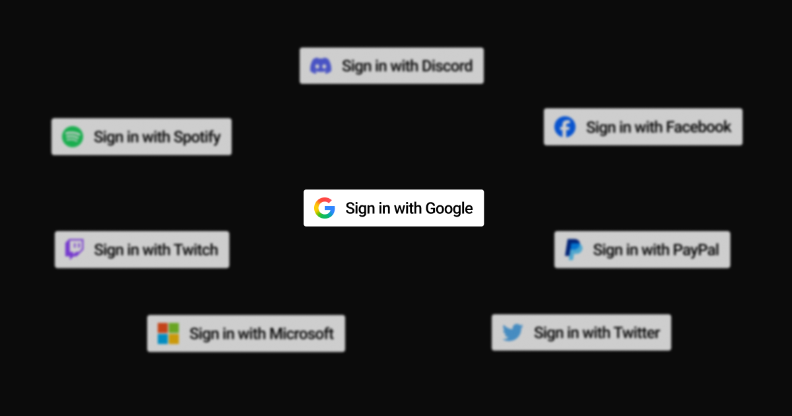

import CentralizedNetwork from "../../components/posts/you-dont-have-a-bluesky-account/CentralizedNetwork.astro";
import AtmosphereNetwork from "../../components/posts/you-dont-have-a-bluesky-account/AtmosphereNetwork.astro";
import AliceJourney from "../../components/posts/you-dont-have-a-bluesky-account/AliceJourney.astro";

You don't have a "Bluesky account". If your first reaction to that sentence was "Uhm, yes I do, I use it regularly", then you're in for a treat. If you've never used Bluesky, no need to worry, because you're also in for a treat!

Today, we'll be talking about what your "Bluesky account" is really capable of, what else you can do with it, and why you should stop calling it your "Bluesky account". But first, let's take a look at why you are calling it that!

## Traditional Accounts

In "classic" apps, you might have an account for each app. You might have a Discord account to chat with your friends, a Spotify account to listen to music, or a Google account to watch YouTube videos. If you think about it, this makes sense: each app needs its own way to get your information, so you have separate accounts, which allows for separate passwords and maybe even email addresses.

But if you think about it a little harder, one of the above makes a little less sense. Why don't you have a YouTube account again?

You see, originally, users on YouTube _did_ have "YouTube accounts"! That is until 2009, when Google, the new owners of YouTube, changed it so you could log in using your Google account. Isn't that incredibly convenient? Well, for the users of the past, it probably wasn't. But for us, it absolutely is! Now, your Google account has become this unified home for all things Google. Your email, your calendar, your web searching, your apps from the Play Store, your documents, your...

You know what, if I continue, this post will be enough to put even the most devoted readers to sleep. What I'm trying to say is: it's kind of awesome you can use that single account to sign into so many apps, some that aren't even made by Google themselves! We all know the "Sign in with Google" button that some websites offer.

## Sign in with...

I just mentioned Google as a prime example of the "Log in with" button. But they're not the only ones, many other companies and platforms offer these buttons! Here's a quick list:

- Apple
- Amazon
- Discord
- Facebook
- Microsoft
- PayPal
- Twitter
- and lots more

Basically, there are a lot of options for the people making their apps to choose from. Yes, people making apps need to manually implement each and every one of them! But they all work the same way: you sign in using some other service, and that other service tells the app you want to log in with who you are. Developers call this standard way of signing into other apps using a specific account "OAuth".

## Oh, Auth.

But with all of these conveniences comes a problem: that account and all data associated with it is now owned by a (multi-trillion dollar) company that probably doesn't give a rat's ass about you specifically, and is incredibly happy to sell that data to their 3,296 "partners" in exchange for that sweet, sweet advertisement data money. And the worst part? Even if you switch apps, they _still_ have all that data! Yes, it's convenient. But at what cost?

Now, I started this post out by mentioning that your Bluesky account isn't just a "Bluesky account". Maybe, while reading, you've already thought about the connection I'm trying to make here: you can use your "Bluesky account" to log into other apps as well! That's not wrong, it is capable of that.

But it can do much, much more. That's because your "Bluesky account" isn't _just_ an account for Bluesky. It's the account you can use to log into a wealth of other apps, all of which (including Bluesky!) make up what we call **The Atmosphere**. And, just in case you ever hear the term **AT Protocol** (ATproto), that's the technology the Atmosphere is built with!

## Welcome to the Atmosphere

With traditional accounts, your account is tied to a single platform or company. You might be able to log into other platforms using that account, if they support it, like Google does. But your precious data still stays with them.

Your "Bluesky account" may allow you to log into specific apps as well, but the data behind it actually isn't owned by Bluesky! To understand why this is the case, we need to understand how Bluesky (and by extension, all other apps in the Atmosphere) work. And to understand what the difference to traditional apps is, we need to understand how they work, too!

A "normal" app works by storing all user data in a database. All user data lives in it. Take Twitter for an example: your posts, your account, your profile picture, everything lives in a single database operated by Twitter. If Twitter ever were to shut down or change owners (luckily, that'd never happen), that data still sits with them.

If you wanted to move to a different platform, for example, Bluesky, you'd have to leave all of this data behind and start from scratch. See the interactive example below: when Twitter shuts down, all data goes with it. Hit the button in the top right for a neat visualization!

<CentralizedNetwork />

That's where the Atmosphere is different.

Instead of a single big server operated by a single owner, the Atmosphere is made up of multiple, smaller servers, that all make up the Atmosphere together. There are two main pieces we should know about, **PDSs** and **AppViews**:

- A **PDS** (shown below as diamond shapes), which stands for **P**ersonal **D**ata **S**erver, is the part of the Atmosphere that holds your data. The "Bluesky account" you own is probably currently located on one of the PDSs operated by Bluesky!
- **AppViews** (shown below as rectangles) are what powers apps in the Atmosphere. They're the equivalent to the servers traditional apps use.

In the (interactive) diagram below, you can see that there are multiple PDSs and multiple AppViews. That's because, in the Atmosphere, you're not required to use any specific PDS or AppView, meaning you can mix and match them.

> **The thing that stores your data can interact with any app that would like to use this data.** In turn, any app that would like to use data can ask any host, **no matter who controls it**.

This leads to a system where, no matter who hosts your account, you can use any app you like, and **you can move between account hosts and apps without losing any data**! That's the reason we call our accounts **Atmosphere accounts**, not "Bluesky accounts".

<AtmosphereNetwork />

If an app ever prompts you for a "handle" and says to log in with your Atmosphere account or Bluesky account, that means it would like to connect to your PDS, so it asks you to allow it access to that data.

This is the "Log in with [APP]" experience! After you enter your handle (for example, `alice.bsky.social`), you'll be redirected to your PDS to log in. Don't be afraid to enter your password here, the app you want to use won't be able to see it. That screen will look something like this:

Anyway, that was a lot of bold text for something fairly theoretical. Let's take a look at how this looks in practice!

Imagine a user, say, "Alice". Alice wants to use a Bluesky client to post about her daily meals to share these posts with the world! Alice signed up using the Bluesky app and used to like it, but she does not want to use Bluesky directly anymore because of personal reasons.

So, instead of the Bluesky app (`bsky.app` or the mobile app), she uses a different client, like [Mu Social](https://mu.social)! She can log in there using her existing account and can continue using Bluesky, but via a European-based website and/or app.

Later, Alice notices that her PDS is still operated by Bluesky. She'd like to have her PDS be located in the EU, though! So, she finds a PDS host operating in the EU, like [Eurosky](https://eurosky.tech), and uses a service like [`move.eurosky.tech`](https://move.eurosky.tech/) to migrate her existing account.

Now, both her account data and the app she uses are from the EU! And if Alice ever decides to switch apps or account hosts again, no problem: moving is free and easy to do! See the (interactive) diagram below.

<AliceJourney />

Truth is, there are many, many Bluesky clients Alice and you can use. Here's a small overview of some I know of:

- [Bluesky](https://bsky.app) itself, run by Bluesky PBC
- [Mu Social](https://mu.social), run by [Eurosky](https://eurosky.tech/), which is entirely EU-based
- [Witchsky](https://witchsky.app), an alternative to the main Bluesky app with some changes to how the app works and looks
- [Blacksky](https://blacksky.community/), developed and maintained by Blacksky Algorithms, which provides curated feeds and moderation tools to support Black social media users
- [Northsky](https://northsky.app), a community service cooperative building a safe and sustainable platform for the 2SLGBTQIA+ and other marginalized communities
- [Anisota](https://anisota.net/), a peaceful social media interface where you flip through a finite deck of cards until you run out of stamina

And of course, there are a _lot_ of Atmosphere apps that you can use with your existing account right now. Platforms like the [ATstore](https://atstore.fyi) make them easy to find! There's a lot of variety, with apps for blogging, productivity, even video games. And yours truly is working on a Discord alternative built on the Atmosphere, called **[Colibri](https://colibri.social)**!

## Where to go from here

That was a _lot_ of information! If you're thinking about moving your Atmosphere account to a different account host that isn't Eurosky, there are resources to help you. [PDS MOOver](https://pdsmoover.com) is an amazing tool for both: it helps you find PDSs, then helps you migrate to them.

I hope your explorations of the Atmosphere will help you find many new apps you enjoy using! The developers making them are incredibly enthusiastic about getting a second chance at building a social internet. So, if you found this post to be helpful in any way, please do share it!

I believe the more people understand the significance of this network and the technology, the better it is going to get. And if you can, feel free to buy me a coffee using the button below. Help fuel my caffeine addiction and all that.

Anyway, that's me out. Until next time!
